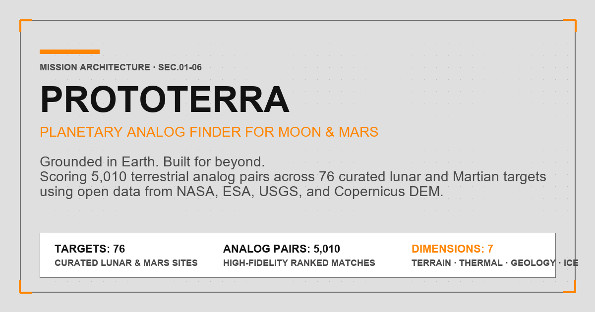
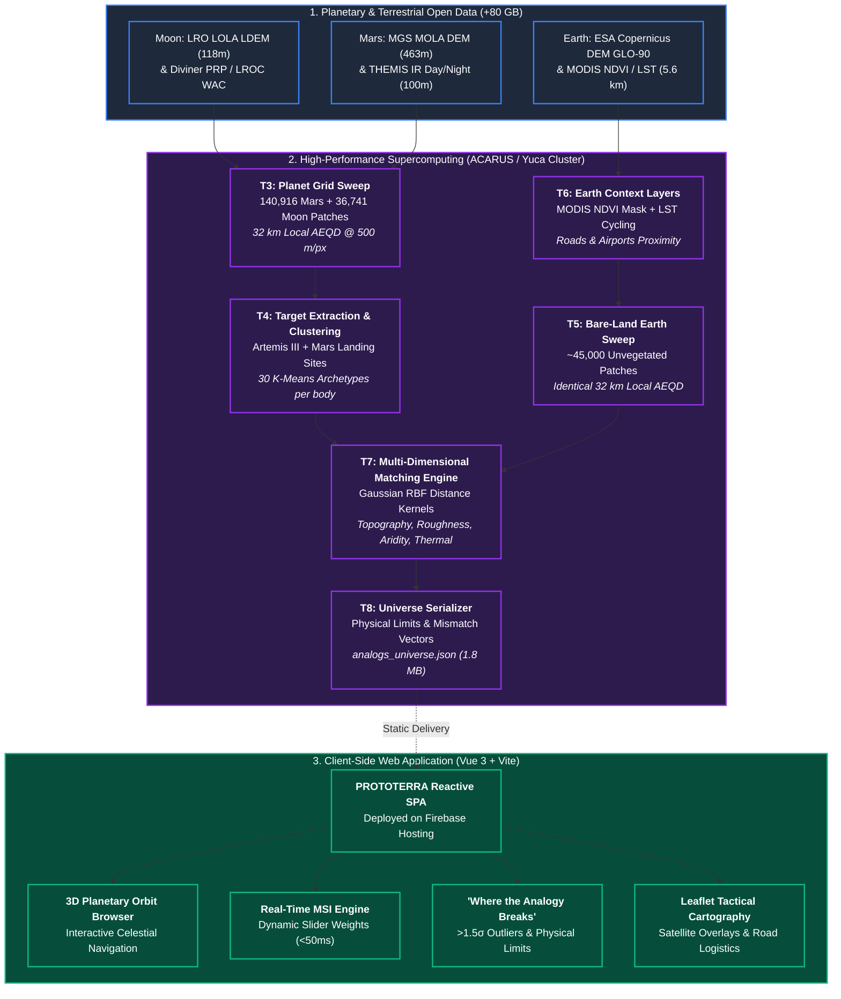

# PROTOTERRA: Planetary Analog Finder for the Moon and Mars

<p align="center">
  
</p>

<p align="center">
  <em>Grounded in Earth. Built for beyond.</em>
</p>

<p align="center">
  <strong>NASA Space Apps Challenge 2026 · Team Endurance CXXV · NASA Space Apps Sonora (Hermosillo, Mexico)</strong>
</p>

<p align="center">
  <a href="https://prototerra.web.app/#/"></a>
  <a href="https://github.com/OwenSolis03/Space_Apps_2026_Analogos_Luna_Marte"></a>
  <a href="https://www.spaceappschallenge.org/"></a>
  <a href="#high-performance-supercomputing-acarus--yuca"></a>
  <a href="#the-crew--acknowledgments"></a>
</p>

<p align="center">
  <a href="https://prototerra.web.app/#/"><b>🚀 Launch Deployed Web App</b></a> •
  <a href="#quick-access--qr-code"><b>📱 Scan QR Code</b></a> •
  <a href="docs/diagrams/system-architecture.html"><b>🏛 System Architecture</b></a> •
  <a href="docs/submission.md"><b>📑 Submission Guide</b></a> •
  <a href="#map-of-contents"><b>🗺 Map of Contents</b></a>
</p>

---

## Map of Contents

1. [About the Project & Challenge](#about-the-project--the-challenge)
2. [Why PROTOTERRA? Key Differentiators](#why-prototerra-key-differentiators)
3. [Quick Access & QR Code](#quick-access--qr-code)
4. [High-Performance Supercomputing (ACARUS / Yuca)](#high-performance-supercomputing-acarus--yuca)
5. [Pipeline Architecture & System Design](#pipeline-architecture--system-design)
6. [NASA & Space Agency Open Datasets](#nasa--space-agency-open-datasets)
7. [Scientific Methodology & Mathematical Formulation](#scientific-methodology--mathematical-formulation)
   - [Standardized 32 km Local AEQD Patches](#1-standardized-32-km-local-aeqd-patches)
   - [Scale-Invariant Morphometric Feature Vector](#2-scale-invariant-morphometric-feature-vector)
   - [Explainable Mission Similarity Index (MSI) via RBF Kernels](#3-explainable-mission-similarity-index-msi-via-rbf-kernels)
   - [Mission Presets](#4-mission-presets)
8. [Where the Analogy Breaks: Physical Limitations](#where-the-analogy-breaks-physical-limitations)
9. [Social Impact & Democratizing Space Exploration](#social-impact--democratizing-space-exploration)
10. [Web Application Overview](#web-application-overview)
11. [Quick Start & Installation](#quick-start--installation)
    - [Frontend Web App](#frontend-web-app-vue-3--vite)
    - [High-Performance Python Pipeline](#high-performance-python-pipeline)
12. [Use of Artificial Intelligence](#use-of-artificial-intelligence)
13. [Repository Structure](#repository-structure)
14. [The Crew & Acknowledgments](#the-crew--acknowledgments)

---

## About the Project & The Challenge

### The NASA Challenge
Addressing the 2026 challenge: **[Identify Earth Locations that Analog the Permanent Moon Base Locations and Mars](https://www.spaceappschallenge.org/2026/challenges/permanent-moon-base-locations-and-mars/)**.

The challenge task:
1. Identify terrestrial locations, environments, or processes that can stand in for future lunar permanent bases (e.g., Artemis III landing zones) and Mars exploration outposts.
2. Characterize them rigorously with open datasets from NASA and partner space agencies.
3. Quantify what makes the analogy scientifically valid, **detail where the analogy breaks**, and explain how the analog accelerates mission planning and instrument testing.

### The Problem with Traditional Analogs
Astronaut training and aerospace hardware trials have historically relied on a handful of world-famous sites (Atacama Desert, Antarctica Dry Valleys, Haughton Crater, Hawaii basalts, Iceland). These locations were chosen predominantly through visual intuition and qualitative tradition. This poses three critical bottlenecks:
- **Repetitive & Cost-Prohibitive Logistics:** Preparing missions in extreme polar or remote island environments requires massive budgets, excluding emerging space programs, universities, and small research institutions.
- **Visual Resemblance is Not Quantitative Data:** A landscape that "looks like Mars" in photographs may have vastly different roughness, slope distributions, or thermal behaviors.
- **One Analog Does Not Fit Every Test:** A terrain ideal for rover suspension testing might be completely unrepresentative of polar cold traps or thermal amplitude cycling.

### The PROTOTERRA Solution
**PROTOTERRA** is an open-source, planetary-scale search engine and analytics suite. It measures terrain patches across Earth, the Moon, and Mars in **exactly the same mathematical manner** (32 × 32 km local Azimuthal Equidistant patches at 500 m/px). Processing tens of gigabytes of raw altimetry and planetary sensor data on the **Yuca supercomputer** (Universidad de Sonora), PROTOTERRA ranks terrestrial candidate sites against 76 planetary targets with an explainable, customizable **Mission Similarity Index (MSI)**, factors in real-world road and airport logistics, and transparently outputs **where the analogy breaks**.

---

## Why PROTOTERRA? Key Differentiators

| Traditional Analog Studies | The PROTOTERRA Standard | Why It Matters for NASA & Space Agility |
| :--- | :--- | :--- |
| **Pre-selected locations:** Starts with known sites (Atacama, Devon Island) and evaluates them. | **Global systematic sweep:** Evaluates every bare-ground 32 km patch on Earth (~45,000 candidates). | Discovers previously unconsidered, accessible candidate sites worldwide. |
| **Subjective visual inspection:** "It looks like the Martian red desert." | **Quantitative morphometry:** 6 scale-invariant physical features extracted identically on all bodies. | Scientifically auditable, reproducible, and mathematically grounded. |
| **Static one-size-fits-all score:** Single static ranking. | **Dynamic Mission Similarity Index (MSI):** Re-weights dimensions according to engineering test goals. | Optimizes site selection specifically for Rover Mobility, Habitat Construction, or Thermal testing. |
| **Analogy limitations treated as footnotes.** | **"Where the Analogy Breaks" as a primary result:** Explicitly flags deviations >1.5σ and immutable planetary physics. | Prevents dangerous engineering false-positives (accounting for 1/6th g, vacuum, and radiation). |
| **No logistical grounding.** | **Logistics-aware scoring:** Distance to nearest road and airport calculated from global vector networks. | Empowers cost-effective field expeditions close to academic hubs. |

---

## Quick Access & QR Code

Test the platform instantly on any desktop, tablet, or smartphone:

<table>
  <tr>
    <td align="center" width="300">
      <a href="https://prototerra.web.app/#/">
        
      </a>
      <br>
      <sub><b>Scan to open on mobile</b></sub>
    </td>
    <td>
      <h3>Experience the Live Platform</h3>
      <p>The interactive web app is fully deployed on Firebase Hosting with high-performance edge caching and strict HTTP security headers.</p>
      <p>👉 <b>Direct URL:</b> <a href="https://prototerra.web.app/#/"><b>https://prototerra.web.app/#/</b></a></p>
      <ul>
        <li><b>Explore the Solar System:</b> Interactive 3D orbital selector for Moon and Mars targets.</li>
        <li><b>Dynamic Mission Tuning:</b> Drag weights in real time (&lt;50 ms re-sorting) for <i>Mobility</i>, <i>Construction</i>, or <i>Thermal</i> tests.</li>
        <li><b>Interactive Earth Analog Map:</b> High-resolution Leaflet cartography with satellite overlays and field accessibility metrics.</li>
      </ul>
    </td>
  </tr>
</table>

---

## High-Performance Supercomputing (ACARUS / Yuca)

Global planetary terrain analysis across three celestial bodies is computationally intensive. PROTOTERRA was engineered and executed in collaboration with **ACARUS** (*Área de Cómputo de Alto Rendimiento de la Universidad de Sonora*) utilizing the **Yuca supercomputer**.

```text
================================================================================
                    YUCA HPC CLUSTER PROCESSING PIPELINE
================================================================================
  [Lunar LOLA DEM]       [Mars MOLA & THEMIS]        [Copernicus DEM GLO-90]
     (118 m/px)              (463 m / 100 m)           (26,475 tiles, 90 m)
          │                        │                            │
          ▼                        ▼                            ▼
  Slurm Task T3            Slurm Task T3                Slurm Task T5 & T6
  36,741 Lunar Patches     140,916 Mars Patches         ~45,000 Bare-Land Patches
  (Local AEQD 32 km)       (Local AEQD 32 km)           (MODIS NDVI Masked)
          │                        │                            │
          └────────────────────────┼────────────────────────────┘
                                   │
                                   ▼
                       Slurm Tasks T4, T7 & T8
               Target Clustering & Multi-Criteria Matching
             (RBF Kernel Distance & Mission Presets Assembly)
                                   │
                                   ▼
                      analogs_universe.json (1.8 MB)
                     Exported to Vue 3 Web Application
================================================================================
```

- **Over 80 GB of Raw Planetary Data:** MOLA, LOLA, THEMIS, Diviner, MODIS, and Copernicus tiles processed in parallel.
- **Slurm Automated Workload Management:** Production job definitions located in [`scripts/jobs/`](scripts/jobs/) orchestrating feature extraction, target clustering, and export.
- **Reproducible Python Pipeline:** Modular architecture with 100% synthetic unit test coverage (`pytest tests/`) runnable without cluster access.

---

## Pipeline Architecture & System Design



```text
Raw Datasets (Cluster)
  │
  ├─ T3 Planet Sweeps ──────► 140,916 Mars + 36,741 Moon patches (500 m/px, 32 km AEQD)
  ├─ T4 Targets ────────────► 76 Anchored Targets (Artemis III, Mars Landing Sites, K-Means Clusters)
  ├─ T6 Earth Layers ───────► MODIS NDVI & LST, Natural Earth Roads, Airports, Countries
  ├─ T5 Earth Sweep ────────► ~45,000 Unvegetated Terrestrial Candidate Patches
  ├─ T7 Matching Engine ────► Multi-Dimensional RBF Kernels, 150 km Spatial Diversity, Mismatch Vectors
  └─ T8 Web Packaging ──────► analogs_universe.json ──► Client-side In-Memory Reactive Vue 3 Engine
```

For complete technical specifications, see our standalone interactive architecture blueprints:
- 🏛 [System Architecture Diagram](docs/diagrams/system-architecture.html)
- 🔄 [Pipeline Lineage & Data Flow](docs/diagrams/pipeline-lineage.html)
- ⚙️ [Pipeline Execution Stages](docs/diagrams/pipeline-stages.html)
- ⚡ [Frontend Sequence & Event Bus](docs/diagrams/app-sequence.html)

---

## NASA & Space Agency Open Datasets

PROTOTERRA is grounded in rigorous scientific datasets published by NASA, the European Space Agency (ESA), the International Astronomical Union (IAU), and the USGS:

| Body | Dataset / Instrument | Resolution | Scientific Application | Primary Source |
| :--- | :--- | :---: | :--- | :--- |
| **Mars** | **MGS MOLA** (Mars Orbiter Laser Altimeter) MEGDR | 463 m/px | Global digital elevation model & morphometric feature extraction | [NASA PDS / USGS](https://astrogeology.usgs.gov/search) |
| **Mars** | **Mars Odyssey THEMIS** (Thermal Emission Imaging) | 100 m/px | Global day & night brightness temperature; relative thermal inertia | [NASA PDS Geosciences](https://pds-geosciences.wustl.edu/) |
| **Moon** | **LRO LOLA** (Lunar Orbiter Laser Altimeter) LDEM | 118 m/px | Polar & equatorial digital elevation model; terrain slope and roughness | [USGS Astrogeology](https://astrogeology.usgs.gov/) |
| **Moon** | **LRO LROC WAC** (Wide Angle Camera) Mosaic | 100 m/px | Surface visual albedo percentile benchmarking | [NASA / ASU](https://wms.lroc.asu.edu/) |
| **Moon** | **LRO Diviner** Polar Resource Products (PRP) | 240 m/px | Maximum/mean surface temperature & subsurface ice stability depth | [NASA PDS Geosciences](https://pds-geosciences.wustl.edu/lro/urn-nasa-pds-lro_diviner_derived1/data_derived_prp/) |
| **Moon** | **Artemis III Candidate Landing Regions** | Vector | South Polar candidate exploration zones (NASA 2024 announcements) | [NASA Artemis](https://www.nasa.gov/artemis/) |
| **Earth** | **ESA Copernicus DEM GLO-90** (26,475 tiles) | 90 m/px | High-resolution global terrestrial elevation baseline | [ESA / AWS Open Data](https://registry.opendata.aws/copernicus-dem/) |
| **Earth** | **Terra/Aqua MODIS MOD13C2** (NDVI) | 0.05° (~5.6 km) | Vegetation suppression mask (retaining only arid & bare land) | [NASA Earthdata](https://doi.org/10.5067/MODIS/MOD13C2.061) |
| **Earth** | **Terra/Aqua MODIS MOD11C3** (LST) | 0.05° (~5.6 km) | Land Surface Temperature day/night amplitude cycling | [NASA Earthdata](https://doi.org/10.5067/MODIS/MOD11C3.061) |
| **All** | **Gazetteer of Planetary Nomenclature** | Point / Feature | Official feature anchors, crater rim names, and spatial coordinates | [USGS / IAU](https://planetarynames.wr.usgs.gov/) |
| **Earth** | **Natural Earth Data** (1:10m Cultural/Physical) | Vector | Global roads, commercial/military airports, and administrative borders | [Natural Earth](https://www.naturalearthdata.com/) |

---

## Scientific Methodology & Mathematical Formulation

### 1. Standardized 32 km Local AEQD Patches
Elevation datums on the Moon and Mars are fundamentally different from Earth's geoid (mean sea level). Direct comparison of raw elevations is mathematically invalid. PROTOTERRA reprojects every terrain patch around its own local geographic center using an **Azimuthal Equidistant (AEQD)** projection:
- **Patch Grid:** 64 × 64 pixels at 500 meters per pixel (32.0 × 32.0 km footprint).
- **Invariance:** Geodesic distances, true slopes, and surface curvatures are preserved uniformly regardless of planetary latitude or body curvature.

### 2. Scale-Invariant Morphometric Feature Vector
From each 64 × 64 patch, a deterministic vector of morphometric metrics is computed:
- **Relief ($\Delta h$):** $h_{\max} - h_{\min}$ within the 32 km window.
- **Mean Slope ($\mu_{\theta}$) & 90th Percentile Slope ($p_{90,\theta}$):** Calculated using 2nd-order central differences in degrees.
- **Terrain Ruggedness Index (TRI):** Root mean squared elevation difference between adjacent pixels.
- **Detrended Surface Roughness ($\sigma_{\text{detrend}}$):** Standard deviation of elevation residuals after subtracting a best-fit 2D planar trend.
- **Hypsometric Integral ($HI$):** Normalized area-elevation distribution:
  $$HI = \frac{\bar{h} - h_{\min}}{h_{\max} - h_{\min}}$$

### 3. Explainable Mission Similarity Index (MSI) via RBF Kernels
Rather than opaque "black-box" neural scores, similarity along each physical dimension $i$ is calculated using a Gaussian Radial Basis Function (RBF) kernel:
$$S_i(x, y) = \exp\left( -\frac{(x_i - y_i)^2}{2\sigma_i^2} \right)$$
where $\sigma_i$ corresponds to the empirical standard deviation of that feature across Earth's bare terrain.

The composite **Mission Similarity Index (MSI)** is the normalized weighted combination:
$$\text{MSI} = \frac{\sum_{i=1}^{M} w_i \cdot S_i}{\sum_{i=1}^{M} w_i}$$

### 4. Mission Presets
Engineers can instantly tailor site rankings for specific operational testing goals:
- 🚜 **Rover Mobility:** Focuses on slope limits, surface roughness, and terrain ruggedness (TRI).
- 🏗 **Habitat & Base Construction:** Emphasizes flat relief, low slopes, and stable regolith analogs.
- 🌡 **Thermal & Atmospheric:** Prioritizes day/night thermal amplitude and extreme temperature contrasts.
- 🌪 **Dust & Regolith Dynamics:** Emphasizes arid, vegetation-free environments with high aeolian activity.

---

## Where the Analogy Breaks: Physical Limitations

A core requirement emphasized by NASA judges is understanding that **Earth cannot replicate space completely**. Uncritical analog claims can lead to catastrophic mission design failures.

PROTOTERRA explicitly calculates and displays **"Where the Analogy Breaks"** for every single site:
1. **Statistical Outlier Flagging:** Any environmental feature where the Earth candidate deviates from the target by more than $1.5\sigma$ is explicitly listed in red with physical units (e.g., *"+14.2° steeper 90th-percentile slope"*, *"-22.1 K lower thermal amplitude"*).
2. **Immutable Planetary Physics:** Every match report includes a mandatory physical boundary matrix:

| Planetary Variable | The Moon | Mars | Earth Analogs (Cannot Replicate) |
| :--- | :---: | :---: | :--- |
| **Surface Gravity** | $0.166\,g$ ($1.62\,\text{m/s}^2$) | $0.380\,g$ ($3.72\,\text{m/s}^2$) | **$1.000\,g$ ($9.81\,\text{m/s}^2$)**: Soil traction, rover rolling resistance, and structural loads must be mathematically scaled. |
| **Atmospheric Pressure** | $\sim 10^{-10}\,\text{Pa}$ (Hard Vacuum) | $\sim 610\,\text{Pa}$ ($\text{CO}_2$ hypobaric) | **$101,325\,\text{Pa}$**: Aerodynamic drag, convective cooling, and plume impingement differ drastically. |
| **Radiation Environment** | Solar cosmic rays & GCRs (unshielded) | Solar UV & GCRs (thin atmosphere) | **Magnetosphere & Ozone Shield**: Earth surface cannot test cosmic radiation dosage or solar proton events. |
| **Hydrological History** | 100% Impact & Volcanic morphology | Past water + current aeolian hyper-arid | **Continuous Biotic & Fluvial Reworking**: Earth rocks undergo precipitation weathering and biological weathering. |

---

## Social Impact & Democratizing Space Exploration

- **Accessible Field Testing for Emerging Nations:** Most analog missions spend tens of thousands of dollars traveling to the Arctic or Hawaii. PROTOTERRA identifies candidate analog sites across Mexico, Latin America, Africa, and Central Asia with verified logistical proximity to highways and regional airports.
- **Academic Empowerment:** Built by public university students in Sonora, Mexico, utilizing open data and local supercomputing (ACARUS / Yuca), proving that high-level planetary engineering tools can be developed anywhere.
- **STEM Education & Public Engagement:** Allows students, educators, and science centers to discover that a mountain range or volcanic field in their own state shares quantified morphometric characteristics with Jezero Crater or the Artemis III South Pole rim.

---

## Web Application Overview

The client application is built with **Vue 3**, **Vite**, and **TypeScript**, operating as an ultra-fast, client-side reactive Single-Page Application (SPA):

- 🪐 **Interactive Orbit Navigation:** Hash-routed 3D visual planetary browser (`/#/`, `/#/results`, `/#/algorithm`, `/#/challenge`, `/#/about`).
- ⚡ **Real-Time Client-Side Filtering:** Moving any weight slider re-calculates MSI across all targets and re-sorts thousands of candidate pairings in **&lt;50 ms** without server round-trips.
- 🗺 **Spatial Radar & Leaflet Mapping:** High-contrast tactical cartography showing candidate site coordinates, satellite imagery, and road network proximity.
- 🔒 **Hardened Security Posture:** Zero external runtime vulnerabilities, self-hosted typography (eliminating third-party CDN tracking), and strict HTTP security headers (`Content-Security-Policy`, `X-Frame-Options: DENY`, `Strict-Transport-Security`).

---

## Quick Start & Installation

### Frontend Web App (Vue 3 + Vite)

**Prerequisites:** Node.js 20+

```bash
# Clone the repository
git clone https://github.com/OwenSolis03/Space_Apps_2026_Analogos_Luna_Marte.git
cd Space_Apps_2026_Analogos_Luna_Marte/app

# Install dependencies
npm install

# Start local development server
npm run dev
```
Open `http://localhost:5173` in your browser.

To generate a production build:
```bash
npm run build
```

---

### High-Performance Python Pipeline

**Prerequisites:** Python 3.11+, GDAL, Rasterio, NumPy, SciPy, Scikit-Learn

```bash
# Create and activate virtual environment
python -m venv .venv
source .venv/bin/activate  # On Windows: .venv\Scripts\activate

# Install pipeline dependencies
pip install -r scripts/pipeline/requirements.txt

# Run synthetic unit test suite (no cluster data required)
pytest -q tests
```

To run a task manually:
```bash
PYTHONPATH=scripts python -m pipeline.targets --help
```

---

## Use of Artificial Intelligence

In compliance with NASA Space Apps Challenge regulations, AI usage in PROTOTERRA was dual-faceted and transparently documented:

1. **Algorithmic Machine Learning:**
   - **K-Means Clustering:** Applied via Scikit-Learn to segment high-dimensional planetary terrain vectors into 30 representative geomorphological archetypes per celestial body.
   - **RBF Distance Kernel Modeling:** Deterministic multivariate distance computation across non-linear environmental dimensions.
2. **AI-Assisted Software Development:**
   - **Claude (Anthropic):** Utilized for initial system architecture planning, mathematical formulations, documentation structuring, and cluster data inspection.
   - **Gemini (Google Antigravity Orchestrator):** Utilized for pipeline module implementation, Slurm batch scripting, synthetic unit test suite generation (`pytest`), frontend reactivity optimization, and security audits.
   - **Human Oversight:** All algorithm definitions, planetary coordinate anchors, cluster job launches, and final scientific conclusions were reviewed, validated, and approved by human team members.

---

## Repository Structure

```text
Space_Apps_2026_Analogos_Luna_Marte/
├── app/                          # Official Vue 3 + Vite web application
│   ├── public/                   # Static assets, QR codes, analogs_universe.json
│   ├── src/                      # TypeScript components, views, algorithms, styles
│   └── package.json              # Frontend dependencies and build scripts
├── data/                         # Hand-written definitions (targets, limits, overrides)
├── docs/                         # Scientific documentation, implementation plans, lineage
│   ├── diagrams/                 # Interactive HTML system architecture diagrams
│   ├── submission.md             # Space Apps submission checklists & timelines
│   ├── value_proposition.md      # Pitch deck talking points & differentiators
│   └── HISTORY.md                # Comprehensive development logbook
├── models/                       # Mathematical similarity model documentation
├── scripts/                      # High-performance processing code
│   ├── pipeline/                 # Core Python modules (geo, features, matching, export)
│   ├── jobs/                     # Slurm cluster submission scripts for Yuca HPC
│   └── tools/                    # Data downloaders and verification utilities
├── tests/                        # Automated unit tests (synthetic data, pytest)
├── prototerra_qr.png             # High-resolution (1000x1000) QR Code
├── prototerra_qr.svg             # Scalable Vector Graphics QR Code
└── README.md                     # Project documentation & overview
```

---

## The Crew & Acknowledgments

### Team Endurance CXXV
We are Computer Science students from Hermosillo, Sonora, Mexico, united by a passion for aerospace technologies, high-performance computing, and scientific problem-solving.

| Member | Focus Area & Role Contributions | Profile |
| :--- | :--- | :--- |
| **Ángel Fernando Bórquez Guerrero** | **Frontend Aesthetic & Development Lead:** Designed the visual aesthetic and user interface styling; programmed and integrated the web application (AI-assisted). | [LinkedIn](https://www.linkedin.com/in/fernandoborquez/) |
| **Elías Peregrina Cázares** | **Pitch Script & Presentation Strategy:** Co-developed the presentation script and pitch narrative in collaboration with Emily and Flor; presentation preparation. | [LinkedIn](https://www.linkedin.com/in/el%C3%ADas-peregrina-c%C3%A1zares-4886503a7/) |
| **Flor María Machado Félix** | **Branding Co-Design, Speech Scripting & Lead Speaker:** Co-created the PROTOTERRA project name; illustrated original logo concepts and drafts; authored the presentation speech and serves as the lead pitch speaker. | [LinkedIn](https://www.linkedin.com/in/flor-maria-machado-felix-a318633a8/) |
| **Emily Margarita Beltrán Zazueta** | **Branding Co-Design, Slide Deck & Content Strategy:** Co-created the PROTOTERRA project name; designed the presentation slide deck layout and visual assets; led research content curation. | [LinkedIn](https://www.linkedin.com/in/emily-beltran-b712a2421/) |
| **Javier Leonardo Miranda Sánchez** | **Frontend Design Architecture:** Conceived and created the initial frontend design proposal, user journey mockups, and early interactive interface concepts. | [LinkedIn](https://www.linkedin.com/in/javier-miranda-sanchez-201aa1383/) |
| **Owen Adiel Solis Zatarain** | **HPC Orchestration & Systems Architecture Lead:** Designed and orchestrated the planetary data processing pipeline on the Yuca supercomputer (ACARUS); core pipeline programming, data engineering, and technical coordination. | [LinkedIn](https://www.linkedin.com/in/owen-solis/) |

### Institutional Acknowledgments
This project was made possible through the generous collaboration and computational resources provided by **ACARUS** (*Área de Cómputo de Alto Rendimiento de la Universidad de Sonora*), granting access to the **Yuca supercomputer**. We also extend our gratitude to the organizing committee and mentors of **[NASA Space Apps Sonora 2026](https://spaceappssonora.org/)** hosted at **Tecnológico de Monterrey, Campus Sonora Norte**.

<p align="center">
  <b>PROTOTERRA · Endurance CXXV · 2026</b><br>
  <em>From Data to Action. Grounded in Earth. Built for Beyond.</em>
</p>
